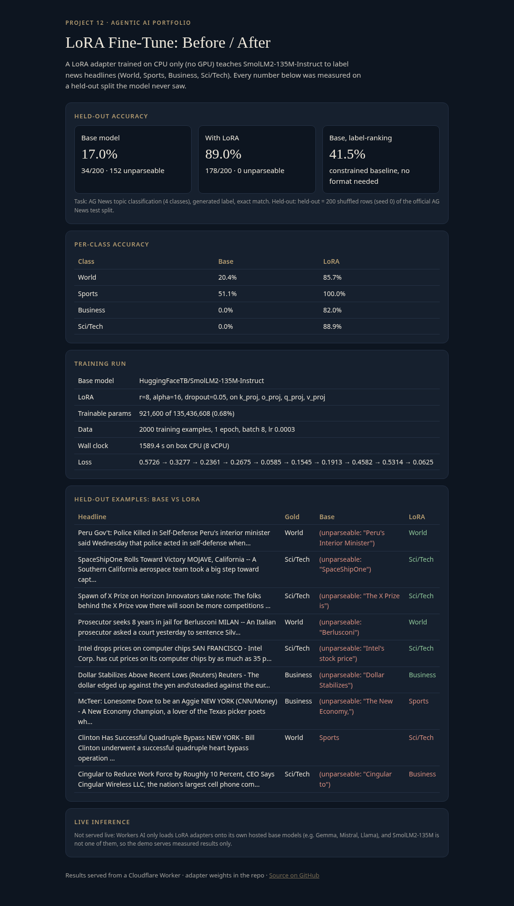
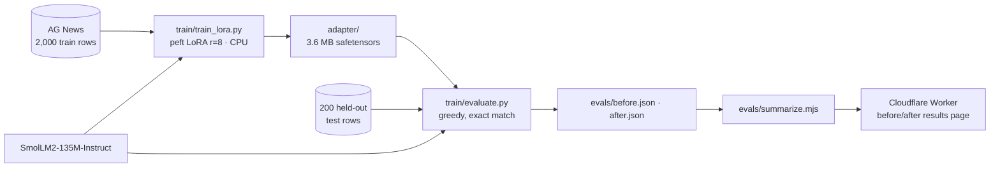

# agent-12-lora-finetune

A **LoRA fine-tune** of a small open model, trained on CPU with Hugging Face `peft` and measured before and after on a held-out split. The results are served from a Cloudflare Worker. Project 12 of the agentic AI portfolio.

**Live demo (before/after results):** https://agent-12-lora-finetune.braylo777.workers.dev
**Adapter:** [`adapter/`](adapter/) in this repo (3.6 MB safetensors), also attached to the [v1.0 release](https://github.com/braylo777/agent-12-lora-finetune/releases/tag/v1.0)



## What it is
- **Base model:** `HuggingFaceTB/SmolLM2-135M-Instruct`
- **Task:** read a news headline and reply with its topic (World, Sports, Business or Sci/Tech). The label is generated and scored by exact match.
- **Data:** [AG News](https://huggingface.co/datasets/fancyzhx/ag_news). Training uses 2,000 shuffled rows (seed 0) of the train split. The held-out set is 200 shuffled rows (seed 0) of the official test split, which the model never trains on.
- **LoRA:** r=8, alpha=16, dropout 0.05, on q/k/v/o projections. That is 921,600 trainable parameters out of 135.4M (0.68%). Loss is computed only on the answer tokens.

## Architecture


## Eval results (measured Oct 27, 2026)
| Model | Held-out accuracy | Unparseable outputs |
|---|---|---|
| Base, same prompt, generated label | **17.0%** (34/200) | 152/200 |
| Base, constrained label-likelihood ranking (format-free baseline) | **41.5%** (83/200) | 0 |
| **Base + LoRA** | **89.0%** (178/200) | 0/200 |

Generated-label accuracy rose by **72.0 points**, and the LoRA adapter beat the format-free baseline by 47.5 points. Per-class LoRA accuracy was World 85.7%, Sports 100%, Business 82.0% and Sci/Tech 88.9%.

Training used 1 epoch of 250 steps at batch 8 and learning rate 3e-4, on the 8-vCPU box with no GPU. The training loss logged every 25 steps went 0.573 → 0.328 → 0.236 → 0.268 → 0.059 → 0.155 → 0.191 → 0.458 → 0.531 → 0.063. These are single-batch values, so they are noisy. Wall clock was 1,589 s, but that is inflated because another CPU job ran alongside it for part of the run, so it is not a clean speed benchmark. Inference averaged 73 ms per example for the base model and 95 ms with the adapter on CPU, in batches of 16. Raw per-example outputs are in [`evals/results.json`](evals/results.json).

**Live serving:** not available on the free tier. Workers AI only loads LoRA adapters onto its own hosted base models, such as Gemma, Mistral and Llama, and SmolLM2-135M is not one of them. So the Worker serves the measured results, and `/api/predict` honestly returns 501.

## Tests
- 5 Worker tests (`npm test`): both models are evaluated on the same split, accuracy matches correct/n, the delta matches, the LoRA config and loss curve are present, and the HTTP routes work, including the 501.
- 4 Python tests (`python test/test_common.py`): label parsing and prompt integrity.

## Reproduce
```bash
pip install torch --index-url https://download.pytorch.org/whl/cpu && pip install transformers peft datasets
python train/evaluate.py > evals/before.json          # base model
python train/evaluate_rank.py > evals/before_rank.json
python train/train_lora.py                            # writes adapter/ and evals/train_log.json
python train/evaluate.py adapter > evals/after.json
node evals/summarize.mjs && npm test && node build.mjs
```

Load the adapter:
```python
from transformers import AutoModelForCausalLM; from peft import PeftModel
m = PeftModel.from_pretrained(AutoModelForCausalLM.from_pretrained("HuggingFaceTB/SmolLM2-135M-Instruct"), "adapter")
```

MIT licensed.

## How to run

```bash
npm install   # dev deps only
npm test      # 8 offline tests, no Workers AI calls
npm run dev   # local wrangler dev
```

## Test results (2026-10-27)

| Suite | Tests | Status |
|---|---|---|
| Unit + edge cases (test/edge.test.js added) | 5→8 | all pass |
| Live demo https://agent-12-lora-finetune.braylo777.workers.dev | HTTP 200 | verified 2026-10-27 |
